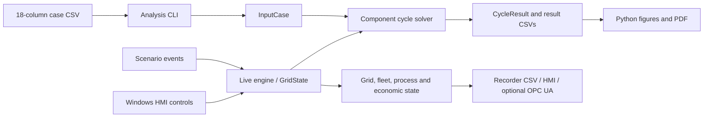

# Engineering workflow

This guide describes the current implementation. Historical revamp documents record development intent and older baselines; the executable, source and [verification matrix](verification_matrix.md) establish current behavior.

## Choose the model and interface



The analysis CLI uses constant properties by default. `engine_init` selects the temperature-dependent property kernel used by live operation and scenarios. This selection is global module state, not an `InputCase` member. Embedded callers should explicitly select/reset it between workflows and must not assume independent instances are thread-safe.

Relative humidity is carried in the case model but does not modify the properties. The variable gas mixture is a fixed representative composition, not equilibrium chemistry. The water/steam functions named `if97_*` use compact correlations, not full IAPWS-IF97. Off-design matching, surge margin, emissions, markets and advanced dispatch contain simplifying correlations or synthetic references.

## Establish a baseline

1. Build and run `make check scenarios` from the repository root.
2. Copy `cases/design_point.csv` to a study input, preserve the schema, and change one assumption at a time. Keep temperature in kelvin and pressure in pascals.
3. Run `thermotwin run <input.csv> <output.csv>` using the executable path appropriate to your shell. Create the output directory first.
4. Require a zero exit status and inspect `converged` and `status` in every result row.
5. Review the physical configuration before comparing results. The hand selftest removes inlet/exhaust losses, the CSV design point includes them, and the live engine selects a different property model.

Numerical agreement with these examples is verification against an internal reference. Plant prediction requires a separately defined calibration/validation dataset, uncertainty budget and acceptance criteria.

## Analysis outputs

The default directory is `output/`. Set `THERMOTWIN_OUTPUT_DIR` to an existing directory to redirect these files. An explicit `run` output path is used as supplied.

| Mode | Files | Meaning |
|---|---|---|
| `run` | `results_run.csv` by default | One row per operating point; states, work, mass flow and electrical/fuel KPIs |
| `degradation` | `results_degradation.csv`, `results_degradation_deltas.csv` | Four presets and differences from clean performance |
| `transient` | `results_transient.csv` | Scenario label, time, gas temperature and metal temperature |
| `uncertainty` | `results_uncertainty.csv`, `results_bias_sensitivity.csv` | Nominal/mean/sigma/percentiles and deterministic bias responses |
| `diagnostics` | `results_diagnostics.csv` | Synthetic true/estimated degradation parameters and error |
| `scenario run --record` | User-selected filename | One row per tick with grid, plant and process signals |

The report pipeline adds named design/sweep CSVs, six figures, `ThermoTwin-F_report.pdf` and `run_manifest.json`. Its PDF covers the classical analysis CLI; advanced HMI exports are separate workflows (`generate_report.py` and the scientific report module).

Power is MW, mass flow kg/s, temperature K and absolute pressure Pa unless the header says otherwise. Efficiency in the CSV is a fraction, not percent. Heat rate is LHV-based kJ/kWh, with `heat_rate = 3600 / thermal_efficiency`. Work columns in result CSVs use kJ/kg even where internal variables use J/kg.

The `converged` flag represents physical sanity checks on an algebraic solution; it is not a general optimizer convergence certificate. Negative/invalid operating points are unsuitable for downstream statistics, even if intermediate numbers are finite.

## Preserve evidence

Prefer one directory per study:

```bash
make
python scripts/run_pipeline.py --output-dir build/studies/baseline
python scripts/run_scenarios.py --record-dir build/studies/scenarios
```

Use `python3` on systems without a `python` command. The pipeline hashes its inputs, executable and outputs, records the Git revision and working-tree dirty state, and saves the executed commands. Archive the manifest with the files, compiler version, dependency versions and your interpretation. An executable hash identifies the binary used; a dirty Git revision alone cannot recreate local edits.

The analysis Monte Carlo uses seed `20240601`. Exact replay is expected in the same compiler/runtime; different compilers or numerical libraries may produce different random sequences or floating-point rounding. Historical neural weights are synthetic artifacts with no plant-data validation claim.

## Build and runtime troubleshooting

| Symptom | Action |
|---|---|
| `gfortran`, `make`, or Python not found | Put the matching toolchain executables on `PATH`; Windows Make may be named `mingw32-make` |
| A Make helper uses the wrong Python | Set `PYTHON=python` or `PYTHON=python3`; activate the study environment first |
| Missing module file or mixed compiler objects | Use a fresh `BUILD=build/<name>` and let Make compile dependencies; do not copy `.mod` files between compilers |
| Unexpectedly stale custom-flag build | Use a new `BUILD` for each compiler/flag combination; Make tracks source dependencies, not arbitrary command-line changes |
| Windows executable will not start | Ensure compatible MinGW runtime DLLs are available via `PATH`; avoid mixing architectures/toolchains |
| CSV header or numeric input error | Use the exact [case schema](../cases/README.md); decimal point, required finite cells, unquoted labels |
| Cannot write results or recorder | Create the parent directory and verify write access; the direct Fortran CLI does not create directories |
| Missing NumPy/Matplotlib | Install `requirements.txt` in the same Python used by Make, or run the pipeline with `--skip-report` |
| GUI closes or a screen fails | Use `make PROFILE=debug gui-debug`; inspect console output and `gui_debug.log` |
| FPM build/link failure | Use the Make workflow; FPM parity is not part of the supported contract |

`make clean` removes the selected build directory and executable targets after checking that they remain inside this repository. It does not delete result examples. Review your `BUILD`/`EXE` overrides first; cleanup refuses repository/source directories and paths outside the workspace.

## Review changes to a model

Run both release and debug checks. Keep physics oracles distinct from software snapshots. When a property change moves a reference, explain the cause, compare the affected outputs, and retain independent conservation/monotonicity checks. Do not label synthetic confidence intervals, fit residuals or a passing scenario as proof of operational accuracy.
