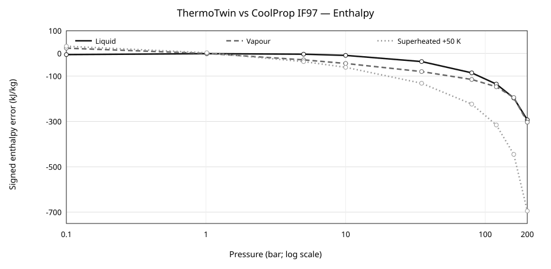
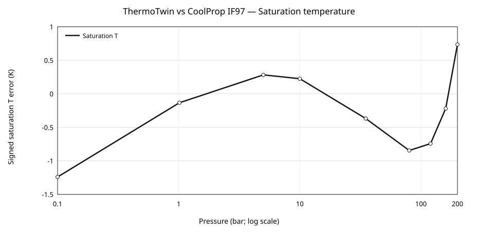

# ThermoTwin-F: architecture, verification and independent property-model benchmarking of an open Fortran power-cycle simulator

**Working research manuscript — version 0.1 (27 October 2026). Not submitted or peer-reviewed.**

**Author:** Abhijith Sivaprasadan ([ORCID 0000-0003-0299-5745](https://orcid.org/0000-0003-0299-5745))  
**Software:** ThermoTwin-F v2.0.0-beta.1, [Zenodo DOI: 10.5281/zenodo.23679426](https://doi.org/10.5281/zenodo.23679426)  
**Exact source:** `ee0461684dbad75c5ab28fe9a66a5f6b32317887`  
**Release CI:** [GitHub Actions run 40424474706](https://github.com/abhijith-sivaprasadan/thermotwin/actions/runs/40424474706)  
**Evidence:** supplementary JSON, file hashes, figures and report in the accompanying `evidence/` directory.  
**Affiliation:** *Author to verify institutional affiliation and permission to use it.*

## Abstract

ThermoTwin-F is an open-source, reduced-order gas-turbine and combined-cycle simulator implemented predominantly in Fortran 2008 for reproducible educational and exploratory power-system studies. A shared input/output model connects steady-state Brayton-cycle calculations with component degradation, lumped-thermal transients, measurement uncertainty, inverse diagnostics and illustrative plant/grid scenarios. We describe its architecture, distinguish numerical verification from external validation, and examine reproducibility using the immutable `v2.0.0-beta.1` release. The release passed ten CI jobs spanning Ubuntu, Windows and macOS, including core regression tests, independent steam-property comparisons, serial/OpenMP equivalence and reporting smoke tests. In a nine-pressure-point comparison against CoolProp 8.0.0's IF97 backend, approximate steam correlations yielded a saturation-temperature mean absolute error of 0.532 K but saturated-vapour and superheated enthalpy mean absolute errors of 104.0 and 215.9 kJ/kg, respectively. The results expose application-limiting thermodynamic approximation errors despite successful software tests. OpenMP CI outputs showed zero reported differences in the checked result fields, although single-shot timing data are insufficient to establish robust scaling. ThermoTwin-F is consequently a reproducible research-software *prototype*, not a validated industrial digital twin. The released artifacts provide a baseline for improved properties, matched-model comparisons and eventual experimental validation.

**Keywords:** research software; gas turbine; combined cycle; Fortran; Brayton cycle; numerical verification; thermophysical properties; reproducibility; OpenMP.

## 1. Introduction

Combined-cycle and gas-turbine studies often couple station-state thermodynamics, off-design behaviour, measurement processing, plant dynamics and scenario analysis. Connecting these tasks within one inspectable source program can help researchers examine assumptions and propagate changes consistently. However, availability of features, the successful execution of automated tests and physically plausible outputs are not equivalent to predictive accuracy. An especially consequential source of uncertainty is the working-fluid property model for steam-bottoming calculations.

This paper documents ThermoTwin-F as an openly released *educational* framework and offers a transparent first set of numerical checks. It does not assert novelty from merely combining common engineering modules or describe the software as a validated replica of a specific plant. Our contribution is a traceable account of (i) design and model boundaries; (ii) numerical and software checks performed on a fixed release; and (iii) measured discrepancies between approximate steam correlations and an independent property formulation.

More comprehensive tools already exist. TESPy supports network-based thermodynamic system simulation [Witte and Tuschy, 2020]; CoolProp provides reference-quality thermophysical-property functionality [Bell et al., 2014]. The official IAPWS-IF97 formulation describes pressure- and region-dependent water/steam properties [IAPWS, 2018]. ThermoTwin-F makes a different trade-off: simplified, inspectable Fortran state equations and extensible plant demonstrations rather than a comprehensive property library or general network solver. These limitations must be made explicit to prevent inappropriate use.

## 2. Architecture and implemented scope

The computational core uses one `InputCase` to represent machine configuration and an operating point, producing one `CycleResult` with station states and derived performance indicators. This shared data contract is used by the main performance solution, degradation analysis, sensor perturbation, inverse diagnostics and batch sensitivity evaluation. Source modules are organized under `src/`, with the Makefile providing the verified build ordering. The native Windows GUI and OPC UA link constitute separate, experimental integration features and were not distributed as a qualified binary in this release.

The simple-cycle module set represents a compressor, combustor, turbine and shaft/generator. A single-pressure heat-recovery steam-generator and bottoming-cycle approximation extend the demonstration to combined-cycle studies. Additional modules illustrate exergy accounting, transient metal heating, data reconciliation, uncertainty propagation, grid response, dispatch and related plant studies. Their existence in the source tree is not evidence that all combinations are experimentally verified.

Two working-fluid treatments are selectable. The reference simple-cycle verification uses fixed heat capacities and heat-capacity ratios. An optional variable-property mode employs gas heat-capacity expressions using the temperature-polynomial terms of NASA seven-coefficient parameterizations. It does **not** implement a full NASA-9 polynomial formulation. Steam functions retaining the historical prefix `if97_*` use compact approximate heat-capacity, latent-heat and saturation formulas. These are **not** IAPWS-IF97 equations despite their legacy function names; their measured discrepancies are presented in Section 4.

The governing energy-balance and component models, exact input-case conventions and documented sanity bounds are in the tagged repository's technical report and verification matrix. A full equation-by-equation source audit remains necessary before journal submission. In particular, historical claims of component performance or thermodynamic consistency must not be promoted from qualitative examples into certified conservation or accuracy bounds.

## 3. Software verification and independent comparison

### 3.1. Reproducible source snapshot

All principal evidence presented here was generated for Git commit `ee0461684dbad75c5ab28fe9a66a5f6b32317887`, which was released as GitHub tag `v2.0.0-beta.1` and automatically archived by Zenodo as DOI `10.5281/zenodo.23679426`. The software release is immutable for the purposes of this study. Later README, DOI-badge and metadata edits to `main` do not change the tag's implementation. The paper evidence bundle retains the released CI artifact IDs, complete machine-readable values and SHA-256 hashes.

The reference build interface is `make` and `make check` with `gfortran`; the Fortran Package Manager manifest is preserved but comprehensive FPM parity is not established. The optional native Windows HMI can be compiled in CI but has not undergone end-to-end user-interface, OPC UA network or clean-machine packaging acceptance.

### 3.2. Analytical and regression checks

The published verification matrix identifies numerical oracles for compressor exit temperature, power, efficiency, lumped-capacitance transient evolution, noise replay and inverse-degradation recovery. Examples include a nominal hand-check of compressor outlet temperature (679.5 K, ±3 K), net power (30.4 MW, ±1.5 MW) and simple-cycle efficiency (0.312, ±0.010). The transient test compares an RK4 trajectory against the analytical exponential response of a lumped thermal node. Inverse tests recover noise-free imposed degradation parameters within documented tolerances. These are **internal verification targets**, not independent experimental measurements of a commercial turbine.

A GitHub Actions workflow passed **10 of 10 jobs** for the tagged commit: six operating-system/build-profile combinations (Linux, macOS and Windows; debug and release), and jobs checking software metadata plus CoolProp reference comparison, TESPy reference calculation, CLI report regeneration and Win32 GUI compilation. All fifteen scenario fixtures were exercised within the core workflows. Passing jobs establishes the tested software behaviours; it does not verify external physical fidelity, nor does compiling the GUI establish that it functions interactively.

### 3.3. Property comparison design

Nine pressure values, `0.1, 1.01325, 5, 10, 35, 80, 120, 160, 200 bar`, were sampled using the Fortran property grid and compared with CoolProp **8.0.0** using its `IF97::Water` backend [Bell et al., 2014]. Reference calls use pressure and vapour quality for saturation states and pressure plus temperature for superheat. Error is defined as

\[
  e_{i,j}=x^{\mathrm{ThermoTwin}}_{i,j}-x^{\mathrm{IF97}}_{i,j}, \qquad
  \mathrm{MAE}_j=\frac{1}{9}\sum_{i=1}^{9}|e_{i,j}|.
\]

We report both MAE and maximum absolute error. At each pressure, the superheated state is **50 K above the saturation temperature produced by the respective implementation**. Therefore that column combines differences in saturation-temperature prediction and in the superheated-enthalpy calculation: it is *not* an error at a rigorously identical thermodynamic state. The comparison is diagnostic and has no predeclared application-specific acceptance threshold.

### 3.4. OpenMP batch comparison

OpenMP parallelizes independent operating-point solves in `sensitivity_driver.run_cases`. The CI benchmarking artifact compares a serial binary with OpenMP builds for 20,000 sample cases per operating system and build configuration, checking its numerical-result fields for equivalence. Each hosted timing has **one trial**; kernel scheduling, processor frequency, operating-system loading and runner hardware were not experimentally controlled. Speedups should therefore be reported as descriptive observations, not scaling laws or performance guarantees.

## 4. Results

### 4.1. Independent steam-property discrepancies

| Property | MAE | Maximum absolute error |
|---|---:|---:|
| Saturation temperature | 0.532 K | 1.240 K |
| Saturated liquid enthalpy | 85.0 kJ/kg | 293.0 kJ/kg |
| Saturated vapour enthalpy | 104.0 kJ/kg | 303.2 kJ/kg |
| Saturated liquid entropy | 0.139 kJ/(kg K) | 0.454 kJ/(kg K) |
| Saturated vapour entropy | 0.182 kJ/(kg K) | 0.471 kJ/(kg K) |
| Superheated (+50 K) enthalpy | 215.9 kJ/kg | 694.7 kJ/kg |

*Table 1. Error magnitudes of the simplified property model relative to CoolProp's IAPWS-IF97 backend over nine pressures, not certified tolerances or experimental accuracy.*

The pressure-resolved data in the supplemental JSON show that deviations grow strongly towards the high-pressure end. At 200 bar, approximate saturated-liquid and saturated-vapour enthalpies differ from the reference by −293.0 and −303.2 kJ/kg; the respective-model +50 K superheat comparison differs by −694.7 kJ/kg. In contrast, the saturation-temperature maximum absolute difference across the nine points is 1.240 K. Thus a close saturation temperature alone is not a reliable proxy for thermodynamic-energy accuracy. The gross high-pressure discrepancy is sufficient to disqualify any assertion of IAPWS-IF97 interchangeability without correction and much wider evaluation.

*Figure 1. Signed enthalpy difference (ThermoTwin − CoolProp) at the nine sampled pressures. Superheat values involve different predicted saturation temperatures.*

*Figure 2. Signed saturation-temperature discrepancy, over the same pressure grid.*

### 4.2. Software and parallel reproducibility

The tagged run reported successful six-platform/profile regression jobs, metadata/property benchmarking, TESPy reference execution, PDF-report smoke test and GUI compile-only test. The six platform/profile OpenMP artifacts showed a **reported maximum relative output error of zero** for the checked case-result fields versus serial execution. This is useful software-consistency evidence for the tested cases and compilers, not a demonstration that the computed thermodynamics are physically accurate.

For illustration, the *release* configuration measured serial-to-two-thread speedup of 1.686 on its hosted Linux runner, 1.204 on macOS and 1.357 on Windows. The corresponding four-thread values were 1.410 on Linux and 1.916 on Windows; the macOS runner's artifact listed only up to two threads. All results were obtained from single timing trials of a roughly millisecond-scale batch on hosted runners. No confidence interval, statistical significance or robust cross-platform performance ranking is claimed.

### 4.3. TESPy fixture audit and exclusion

A standalone Rankine reference fixture was executed by TESPy 0.11.2. This is an independent illustrative calculation with nonmatching boundaries: it is **not** a head-to-head ThermoTwin comparison. A paper-evidence audit further detected a unit-handling defect in the fixture's output packaging. The script configures network power units as **MW** and retrieves `turb.P.val` and `pump.P.val`, but labels those values as watts and divides their difference by `10^6` to report net MW. The original artifact therefore reports an implausible `1.2987 × 10⁻⁵ MW` net power for its stated inputs. Interpreting `.val` in the configured MW units would instead give about **12.99 MW**, but that is only a unit-based reinterpretation of the existing data, **not a freshly rerun or externally checked result**. We exclude both values from model-validation claims and identify correction and re-execution as future work. The original fixture JSON is preserved unchanged in the evidence bundle, with a separately labeled audit file.

### 4.4. Reporting pipeline

The tagged CI regenerates the original CLI report PDF and figures and checks that a nonempty report file was produced. The resulting PDF and figure outputs are included as a *smoke-test artifact*; their numerical contents have **not** undergone a line-by-line, source-to-figure audit and are not used as research outcomes in this manuscript.

## 5. Discussion and limitations

Software verification asks whether selected implementations satisfy defined equations and self-consistency tests. Validation asks whether a model reproduces independent observations to the accuracy needed for its intended use. In the present study, the former has evidence and the latter does not. No measured turbine or steam-cycle dataset, measurement uncertainty propagation study, or external manufacturer operating envelope is supplied for this release. The advanced grid/market/AI scenarios also use representative or synthetic inputs and should be interpreted as demonstrations.

The principal quantitative limitation is not a lack of executable tests but the simplified water/steam-property model, whose large enthalpy deviations affect potential heat balance and turbine/HRSG calculations. The CoolProp grid is sparse, contains only one superheat offset and does not establish where approximations are acceptable. Future analyses should test matched states and realistic duty cycles, define error thresholds in advance, quantify propagated KPI errors, and include boundaries and near-critical behaviour. Agreement with a second software implementation alone would still not establish physical validation.

Furthermore, OpenMP speedups are workload- and system-dependent; timed single-shot CI values cannot support claims of linear or generalizable acceleration. The native Windows interface and OPC UA bridge have compile-level rather than operational evidence. The detached TESPy fixture contains a unit-reporting error and should not be used as a published validation result.

From a research-software perspective, the project offers an openly inspectable, DOI-frozen implementation, full traceable CI artifacts and failure disclosure. But software packaging, documentation usability, external use and research impact require more evidence before an appropriate software-journal submission. As of October 2026, the GitHub project established in June 2026 also lacks six months of public history, a current explicit gate in the Journal of Open Source Software submission guidance [JOSS, 2026]; **this document is not yet a submission-ready JOSS paper**.

## 6. Conclusions

ThermoTwin-F v2.0.0-beta.1 provides a citable and cross-platform-tested baseline for educational gas-turbine and combined-cycle scenario studies. Internal analytical checks, regression coverage and serial/OpenMP consistency are documented for the tested source snapshot. The independent nine-point property comparison simultaneously reveals material steam-enthalpy discrepancies that prevent a claim of IAPWS-IF97 fidelity or validated commercial-plant prediction. Preserving these limitations and the complete machine-readable benchmark evidence makes the software a suitable basis for a reproducible *software-verification study*, while highlighting concrete requirements for a later accuracy-focused release and scientifically stronger manuscript.

## Software and data availability

- Frozen source and archived release: https://doi.org/10.5281/zenodo.23679426 (MIT).
- GitHub tag: https://github.com/abhijith-sivaprasadan/thermotwin/tree/v2.0.0-beta.1.
- All-version concept DOI: https://doi.org/10.5281/zenodo.23679256.
- Exact source commit: `ee0461684dbad75c5ab28fe9a66a5f6b32317887`.
- Release test and data artifacts: https://github.com/abhijith-sivaprasadan/thermotwin/actions/runs/40424474706.
- Supplement here: `evidence/manifest.json`, `evidence/raw/*.json`, `evidence/figures/*.png`, `evidence/report/`; see SHA-256 hashes in the manifest.
- Note that GitHub Actions artifacts have finite retention. The accompanying bundle is a **preservation copy**, not yet a separately published supplemental Zenodo DOI.

## Generative-AI assistance and author verification

Generative AI assisted repository audit, the release and CI workflow, evidence organization, and preparation of this manuscript draft. The human author is responsible for verifying all source-code descriptions, unit conventions, calculation results, references, originality, authorship/affiliation statements, and manuscript claims before submission. Passing automated checks does not replace this review.

## References

Bell, I. H., Wronski, J., Quoilin, S., & Lemort, V. (2014). Pure and pseudo-pure fluid thermophysical property evaluation and the open-source thermophysical property library CoolProp. *Industrial & Engineering Chemistry Research, 53*(6), 2498–2508. https://doi.org/10.1021/ie4033999

International Association for the Properties of Water and Steam (IAPWS). (2018). *Revised release on the IAPWS industrial formulation 1997 for the thermodynamic properties of water and steam (R7-97(2012)).* https://iapws.org/technical-guidance/release/IF97-Rev

Witte, F., & Tuschy, I. (2020). TESPy: Thermal Engineering Systems in Python. *Journal of Open Source Software, 5*(49), 2178. https://doi.org/10.21105/joss.02178

Journal of Open Source Software. (2026, accessed October 27). *Submitting a paper to JOSS* and *review criteria*. https://joss.readthedocs.io/en/latest/submitting.html ; https://joss.readthedocs.io/en/latest/review_criteria.html
